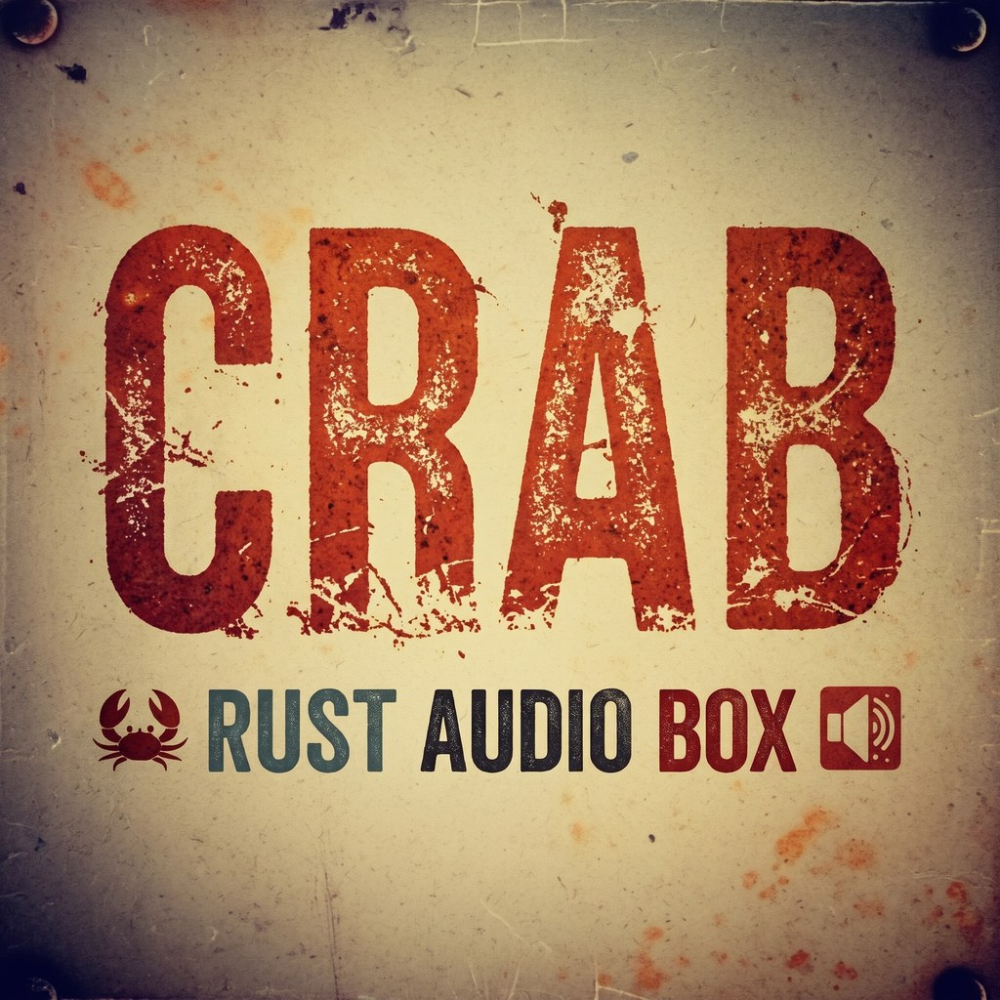
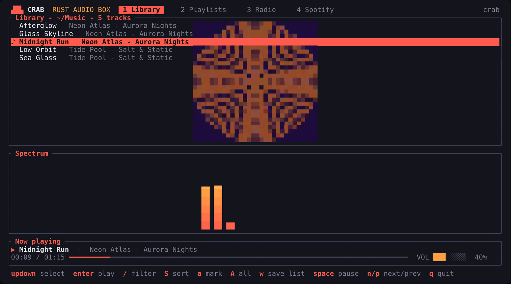
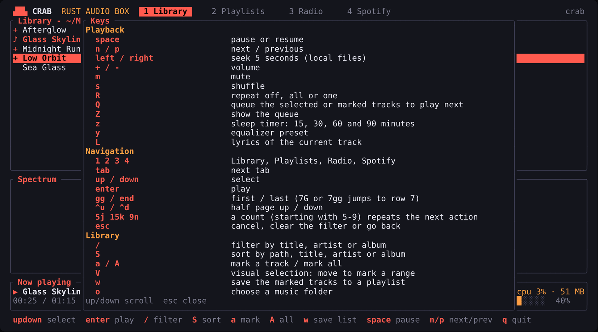
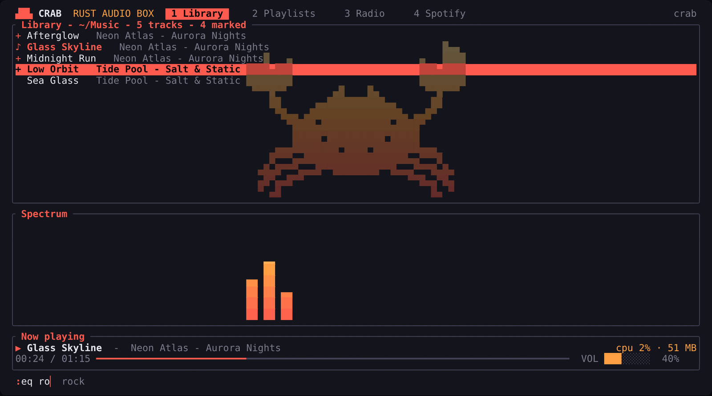
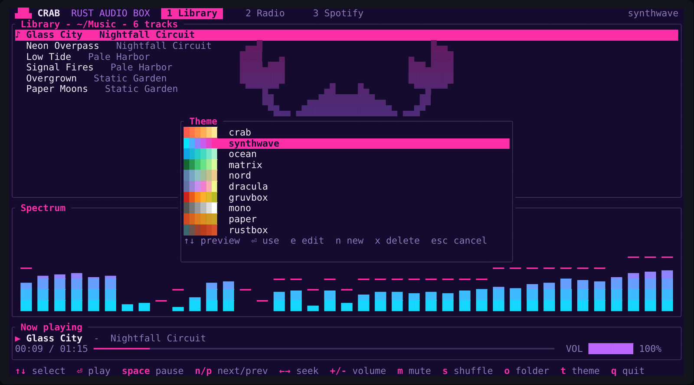
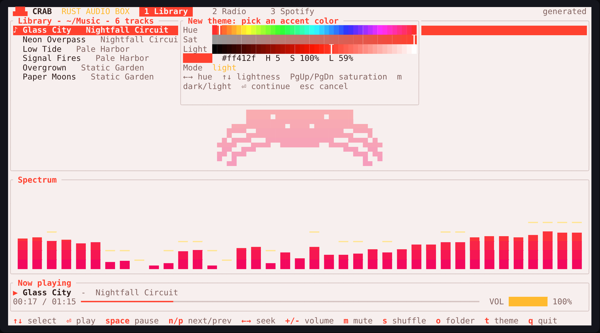
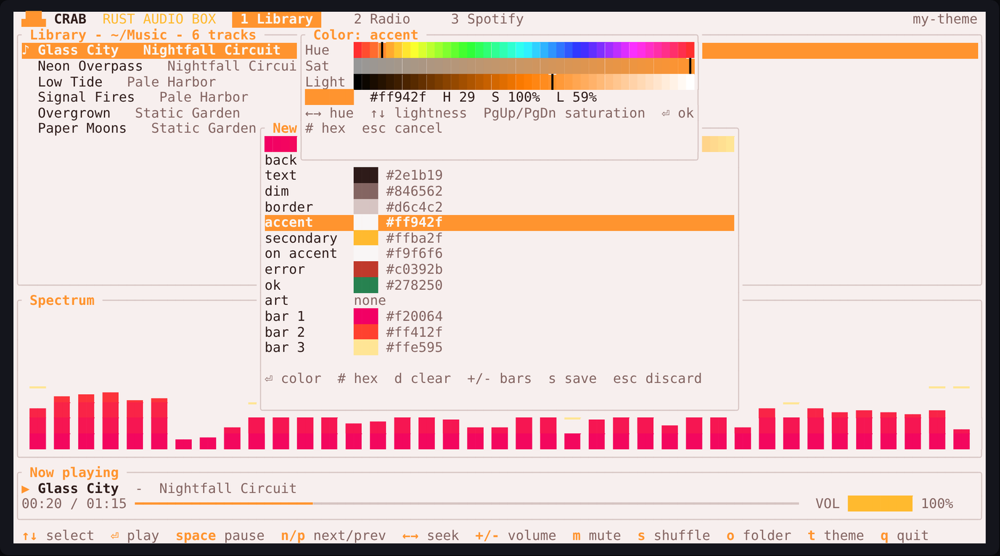

# CRAB - Rust Audio Box

A terminal audio player written in Rust. It plays local files, internet radio and Spotify, and draws a live spectrum analyzer of whatever is playing.

## Features

- Local library with automatic reload when files are added or removed, a built-in folder browser, tag reading (title, artist, album, track number), sorting and a live filter
- Embedded cover art (or `cover.jpg` and similar next to the files) drawn in the player as colored half blocks
- Favorites: `f` adds or removes a ♥, `F` shows only your favorites
- Repeat modes, a play queue ("up next"), a sleep timer and a key help overlay (`?`)
- Gapless playback, optional crossfade, a ten band equalizer with presets and ReplayGain
- Synced (`.lrc`) and plain lyrics, shown in an overlay
- Scrobbling to ListenBrainz
- Media keys and desktop media controls (MPRIS) on Linux
- Playback state (shuffle, repeat, volume, last track and position) restored on the next start
- A `vim` key preset, a `:` command line, keys you can remap and a CPU and memory readout
- Mouse support: click rows and tabs, double click to play, click the progress bar to seek, scroll wheel
- Playlists that mix tracks from any folder, including files that are not in your library
- Internet radio with live track titles (ICY metadata) and automatic reconnection
- Spotify through Spotify Connect (optional, see the notice below)
- Six live visualizers (bars, mirror, line, dots, waveform and spectrogram), switchable with a key
- Themes: ten built-in ones plus your own, made in the built-in theme editor or defined in a TOML file
- Volume follows the system output volume, so changes made outside CRAB show up

## Install

You need Rust 1.89 or newer and the ALSA development headers.

| Distribution | Packages |
| --- | --- |
| Debian / Ubuntu | `libasound2-dev pkg-config` |
| Fedora | `alsa-lib-devel` |
| Arch | `alsa-lib` |

Then build and install it to `~/.local/bin`:

    make
    make install

Or only build it and run it from the repository:

    make
    ./target/release/crab ~/Music

Spotify support is a Cargo feature that is on by default. Pass `SPOTIFY=0` to `make` to leave it out. `PREFIX` changes the install location, so a system-wide install is `make && sudo make install PREFIX=/usr/local`, and `make uninstall` removes the binary. `make test` runs the tests and `make help` lists the targets. `make` wraps plain `cargo build --release --locked`, which works too.

## Usage

    crab [PATH...]   start the player scanning the given folders or files
    crab login       sign in to Spotify (Premium account required)
    crab --version
    crab --help

Without arguments CRAB opens the folders you used last time, or `~/Music` the first time.

| Key | Action |
| --- | --- |
| Up / Down, `j` / `k` | select |
| Enter | play |
| Space | pause or resume |
| `n` / `p` | next / previous |
| Left / Right | seek 5 seconds (local files) |
| `+` / `-` | volume |
| `m` | mute |
| `s` | shuffle |
| `R` | repeat: off, all, one |
| `Q` | add the marked tracks, the selected track or the open playlist to the queue |
| `Z` | show the queue (Enter plays now, `x` removes, `X` clears) |
| `S` | sort the library by path, title, artist or album |
| `z` | sleep timer: 15, 30, 60 and 90 minutes, then off |
| `y` | next equalizer preset |
| `L` | lyrics of the current track |
| `i` / `E` | import / export an `.m3u` playlist (Playlists tab) |
| `?` | key help |
| `:` | command line |
| `I` | show or hide CPU and memory use |
| `f` / `F` | add or remove a favorite / show only favorites |
| `>` / `<` | next / previous track |
| `o` | choose a music folder |
| `a` / `A` | mark a track / mark all (Library); create a playlist or add files to one (Playlists) |
| `d` / `D` | mark a track of an open playlist / mark all |
| `w` | save the marked tracks to a playlist (Library) |
| `v` | next visualizer |
| `c` | show or hide the clock in the header |
| `/` | find radio stations (Radio tab); filter the library as you type in the Library tab (Esc clears, Enter keeps) |
| `x` | remove the selected station, playlist or playlist track, press twice |
| `t` | open the theme picker |
| `r` | reload the configuration |
| Tab, `1` `2` `3` `4` | switch between Library, Playlists, Radio and Spotify |
| `q` | quit |
| Esc | cancel what is in progress (a station that is connecting, a dialog); it never quits |

### Playback

Tags are read with lofty. Cover art comes from the file itself or from `cover`, `folder`, `front`, `album` or `albumart` (`.jpg` or `.png`) in the same folder.

    [library]
    sort = "path"        # path, title, artist or album

    [audio]
    replaygain = true    # apply the ReplayGain track gain tag when present
    gapless = true       # start the next track without a gap
    crossfade = 0.0      # seconds; above 0 it replaces gapless
    eq = "flat"          # flat, bass, treble, vocal, rock, electronic, loudness
    # eq_bands = [0, 0, 0, 0, 0, 0, 0, 0, 0, 0]   # dB at 31 Hz ... 16 kHz, overrides eq

`y` cycles the equalizer presets and saves the choice. A track is crossfaded only when it is longer than three times the fade.

Lyrics are read from a `.lrc` or `.txt` file with the same name as the track, or from the lyrics tag. With a synced file the current line follows the song.

The last state (shuffle, repeat, volume, track, position and favorites) is stored in `~/.local/state/crab/state.toml`.

### Scrobbling

CRAB can send listens to [ListenBrainz](https://listenbrainz.org). Put your user token (from your ListenBrainz profile) in `config.toml`, or in the `CRAB_LISTENBRAINZ_TOKEN` environment variable:

    [scrobble]
    listenbrainz_token = ""

The playing track is announced as "now playing", and it is scrobbled after half of it (or four minutes) has been played. Tracks shorter than 30 seconds are not scrobbled.

### Media keys

On Linux CRAB registers as an MPRIS player, so media keys, desktop widgets and `playerctl` work. The cover is shown there too. This part is not available on macOS or Windows yet.

### Mouse

Click a row to select it and double click to play it. Click a tab to switch, click the progress bar to seek (local files), scroll to move the selection. Set `mouse = false` in `config.toml` to turn it off.

### Key presets

CRAB has three key presets, chosen with `:keys crab`, `:keys vim` or `:keys custom` (or `preset` in `config.toml`).

| Preset | Keys |
| --- | --- |
| `crab` | The default. Arrows, Page Up/Down, Home and End to move, and the action keys listed above. |
| `vim` | Everything in `crab`, plus `j` `k` `h` `l`, `gg` and `G`, Ctrl-d and Ctrl-u, `V` visual selection and counts. |
| `custom` | A copy of `crab` or `vim` with your own changes. |

`crab` and `vim` are never modified. Any change you make goes to `custom`, so switching back to `crab` or `vim` is always possible, and your custom keys are kept for later.

In the `vim` preset a number typed before an action repeats it: `5j` moves five rows, `9n` skips nine tracks, `7G` goes to row 7. Counts start with a digit that is not a tab key (5 to 9) and can continue with any digit, so `15j` works. `V` starts a visual selection in the Library or in an open playlist: move with `j` and `k` and every track in the range is marked.

### Commands

`:` opens a command line at the bottom. Tab completes command names, action names and values (`:eq ro` becomes `:eq rock`); when several options match they are listed in the footer and Tab cycles through them. Up and down recall the previous commands. Rarely used actions are also available as commands:

| Command | Does |
| --- | --- |
| `:sort album` | sort by path, title, artist or album |
| `:sleep 30` / `:sleep off` | sleep timer in minutes |
| `:eq rock` | equalizer preset |
| `:repeat all` / `:shuffle on` | playback modes |
| `:volume 60` | volume in percent |
| `:seek 1:30`, `:seek +10` | seek to a time or by seconds |
| `:theme name`, `:viz mirror` | switch theme or visualizer |
| `:tab radio`, `:save`, `:import`, `:export` | jump and open dialogs |
| `:shuffle`, `:mute`, `:fade 3` | shuffle, mute, crossfade length in seconds |
| `:goto text` | select the first track that matches |
| `:play text` | play the first track that matches |
| `:find text`, `:find` | filter the library, or clear the filter |
| `:add text` | queue every track that matches |
| `:fav`, `:favs` | toggle a favorite, show only favorites |
| `:keys vim`, `:map`, `:unmap`, `:reset` | key presets and remapping, see below |
| `:stats` | CPU, memory and uptime of CRAB |
| `:play`, `:pause`, `:next`, `:prev`, `:stop`, `:queue`, `:lyrics`, `:clock`, `:reload`, `:folder`, `:help`, `:quit` | the matching actions |

### Remapping keys

From inside CRAB, `:map sleep Z` binds an action and saves it. `:map sleep` shows its keys, `:unmap sleep` removes them, and `:reset sleep` goes back to the key of the preset it started from. The first change switches to the `custom` preset, based on the preset you were using.

The same thing in `config.toml`:

    [keys]
    preset = "custom"
    base = "vim"           # crab or vim: what custom starts from

    [keys.custom]
    sleep = "Z"
    next = ["n", ">", "ctrl-n"]
    lyrics = []            # no key

A binding replaces the keys of that action and takes a key away from any other action that used it. A key is a single character, or one of `space`, `enter`, `esc`, `tab`, `backtab`, `backspace`, `delete`, `up`, `down`, `left`, `right`, `home`, `end`, `pageup`, `pagedown`, `f1` to `f12`, optionally with the `ctrl-` prefix. The action names are the ones `:map` accepts: quit, cancel, back, search, repeat, queue, queue-view, help, mark, mark-all, sort, track-mark, track-mark-all, save, remove, open-list, import, export, sleep, eq, lyrics, visualizer, clock, folder, tab-next, tab-prev, tab-1 to tab-4, up, down, page-up, page-down, half-up, half-down, top, bottom, play, pause, next, prev, seek-forward, seek-back, volume-up, volume-down, mute, theme, reload, shuffle, visual, command, stats, favorite and favorites.

The key help (`?`) and the footer always show the keys you have now.

### Resource usage

`I` shows or hides the CPU and memory used by CRAB next to the badges of the player (for example `cpu 3% · 41 MB`), and `:stats` prints the detail with the uptime. The CPU is a percentage of one core.

### Folder browser

Press `o` to browse folders without leaving CRAB. Enter opens a folder, Backspace goes up, Space makes the current folder your library, `a` adds it to the library, `/` lets you type a path, `~` jumps to your home folder and `.` shows hidden folders. The chosen folders are remembered for the next start. Folders given on the command line take priority.

### Playlists

The Playlists tab (`2`) holds your playlists. They are not tied to the library folders, so one list can mix tracks from anywhere on disk.

To create a list from files that are not in your library, open the Playlists tab and press `a`, type a name, then browse to the files. In the browser Enter opens a folder or adds the highlighted file, Space marks files or folders (a `+` appears, and marks are kept while you move between folders), `a` adds everything marked, `A` adds every audio file in the current folder, and Esc finishes. A marked folder is searched recursively. Press `a` inside an open playlist to add more later.

To build one from tracks you already see in the Library tab, press `a` on each track to mark it (a `+` appears) or `A` to mark all of them (again to clear), then `w` and type a name. Typing the name of an existing list adds to it, and Up and Down cycle through the lists you have. Without marks, `w` saves the selected track.

Inside an open playlist, `d` marks tracks and `D` marks all of them, and `x` twice removes the marked tracks (or the selected one when nothing is marked).

On the list of playlists, Enter plays the selected playlist from its first track, continuing through the list (shuffle applies to what comes next), and `e` opens it to see and edit its tracks. Inside an open playlist, Enter plays from the selected track. Esc or Backspace goes back to the list of playlists, and `x` twice deletes the selected playlist. Missing files are shown in the error color and skipped. Playlists are saved in `~/.config/crab/playlists.toml`.

### Visualizers

Press `v` to cycle through the visualizers. The one you leave selected is saved to `config.toml` and used on the next start.

| Style | Looks like |
| --- | --- |
| `bars` | classic spectrum bars with peak markers |
| `mirror` | the same bars, mirrored above and below a center line |
| `line` | the spectrum as a smooth line |
| `dots` | the spectrum as a stippled area |
| `wave` | the waveform of the audio, like an oscilloscope |
| `waterfall` | a spectrogram: the spectrum scrolling down over time |

`bar_width` and `gap` apply to `bars` and `mirror`, and `peaks` to `bars`.

### Clock

Press `c` to show or hide a clock in the header, next to the theme name. It is shown in the accent color, and it is left out when the window is too narrow to fit it beside the tabs. Whether it is shown is remembered between runs.

    [clock]
    show = false
    hour12 = false
    seconds = true

`hour12 = true` switches to a 12 hour clock with an AM or PM label. With `seconds = false` the clock shows only hours and minutes and the colon blinks every second.

## Radio

Stations live in `~/.config/crab/stations.toml`, which is created on first run:

    [[station]]
    name = "My station"
    url = "https://example.com/stream.mp3"

MP3, AAC and Ogg streams work, and `.pls` and `.m3u` playlist URLs are resolved automatically. HLS streams (`.m3u8` lists of segments) are not supported.

### Finding stations

Press `/` in the Radio tab to search the community directory at [radio-browser.info](https://www.radio-browser.info). The country field starts with the one from your locale (for example `ES` for Spanish stations), and the name field is optional: leave it empty to see the most voted stations of that country. Enter searches, Tab moves between the fields and the results, and Enter on a result saves it to `stations.toml` and starts playing it. Only streams CRAB can play are listed. Press `x` twice on a station to remove it from your list.

## Spotify

After `crab login`, CRAB appears as a Spotify Connect device named "CRAB". Open Spotify on any device and pick it from the devices menu. The audio plays through CRAB and drives the spectrum bars. CRAB has no search of its own: you choose what to play from the Spotify app.

CRAB is an independent project. It is not affiliated with, endorsed by or sponsored by Spotify. The integration is built on [librespot](https://github.com/librespot-org/librespot), an unofficial open source client, whose authors warn that using it to connect to Spotify is probably forbidden by Spotify's terms and that you use it at your own risk. A Spotify Premium account is required. If you are not comfortable with that, build CRAB without the `spotify` feature.

## Configuration

`~/.config/crab/config.toml` is created on first run. Press `r` inside CRAB to reload it.

    theme = "crab"
    show_art = true
    art_strength = 0.35
    art_file = "~/.config/crab/art.txt"

    [visualizer]
    style = "bars"
    bar_width = 2
    gap = 1
    peaks = true

    [themes.mine]
    base = "nord"
    accent = "#ff8800"
    bars = ["#5e81ac", "#88c0d0", "#ebcb8b"]

Built-in themes: `crab`, `synthwave`, `ocean`, `matrix`, `nord`, `dracula`, `gruvbox`, `mono`, `paper` and `rustbox`.

### Theme picker and editor

Press `t` to open the theme picker. Moving through the list previews each theme live, Enter keeps the one you chose and saves it to `config.toml`, and Esc goes back to the previous one.

Press `n` in the picker to generate a whole theme from a single color. Choose the accent with the arrow keys (left and right change the hue, up and down the lightness, PgUp and PgDn the saturation), switch between a dark and a light variant with `m`, and the interface updates as you go. Enter takes you to the editor to fine tune it. Press `e` in the picker to edit the highlighted theme instead, or `x` to delete one of your own themes (it asks for confirmation). Built-in themes cannot be deleted.

In the editor, Enter on a color opens the same color picker, and `#` lets you type a hex value such as `#ff5a4e`. `d` clears the optional `background` and `art` colors, `+` and `-` add or remove colors of the bar gradient (2 to 6), and `s` asks for a name and writes the theme to the `[themes.<name>]` section of `config.toml`, leaving the rest of the file untouched. Esc discards the changes.

A custom theme can set `base`, `background`, `text`, `dim`, `border`, `accent`, `secondary`, `on_accent`, `error`, `ok`, `art` and `bars`, a list of two or more colors that form the bar gradient. Anything you leave out is inherited from the base theme. Defining a theme with a built-in name overrides it.

A crab is drawn behind the lists and scales with the terminal size. `art_strength` (0.05 to 1.0) sets how bright it is, `show_art = false` hides it, and `art_file` replaces it with any text file, centered behind the lists.

## Files

| Path | Purpose |
| --- | --- |
| `~/.config/crab/config.toml` | themes and display options |
| `~/.config/crab/stations.toml` | radio stations |
| `~/.config/crab/playlists.toml` | playlists |
| `~/.local/state/crab/library_roots.txt` | folders remembered from the folder browser |
| `~/.cache/crab/crab.log` | error log |
| `~/.cache/crab/spotify/` | saved Spotify credentials |

## Support

CRAB is free and open source. If you enjoy it and want to give something back, you can [buy me a coffee on Ko-fi](https://ko-fi.com/juaprebo). Donations are voluntary, unlock nothing and have no relation to the Spotify integration.

## Contributing

Issues and pull requests are welcome. Run `cargo fmt` and `cargo test` before sending a change. Unless you state otherwise, any contribution you submit is licensed under the same terms as the project, as described below.

## License

Licensed under either of

- Apache License, Version 2.0 ([LICENSE-APACHE](LICENSE-APACHE))
- MIT license ([LICENSE-MIT](LICENSE-MIT))

at your option.
